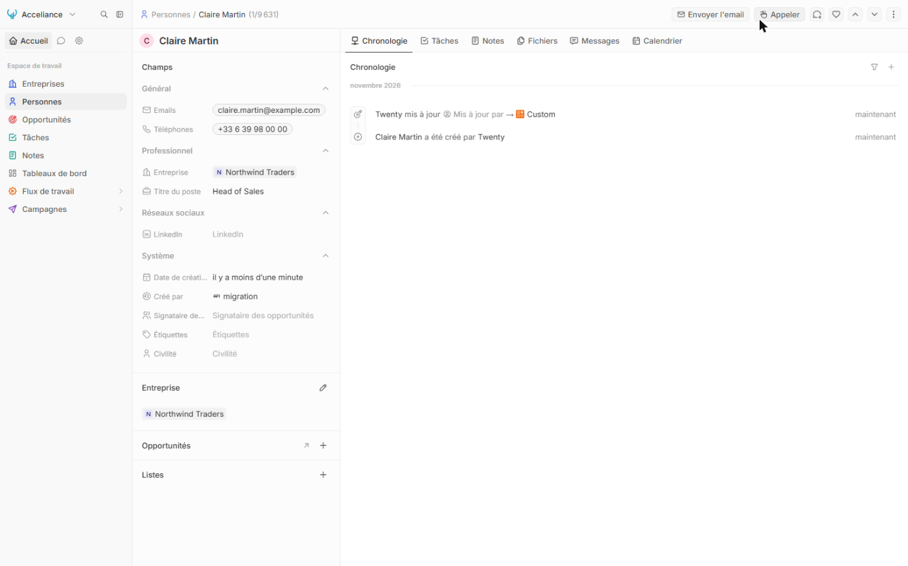
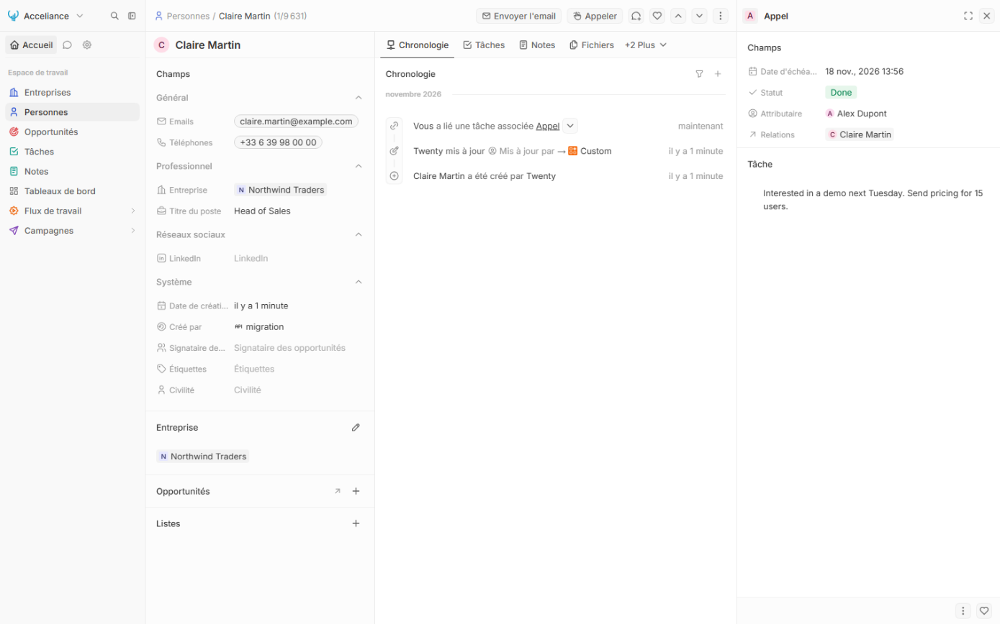
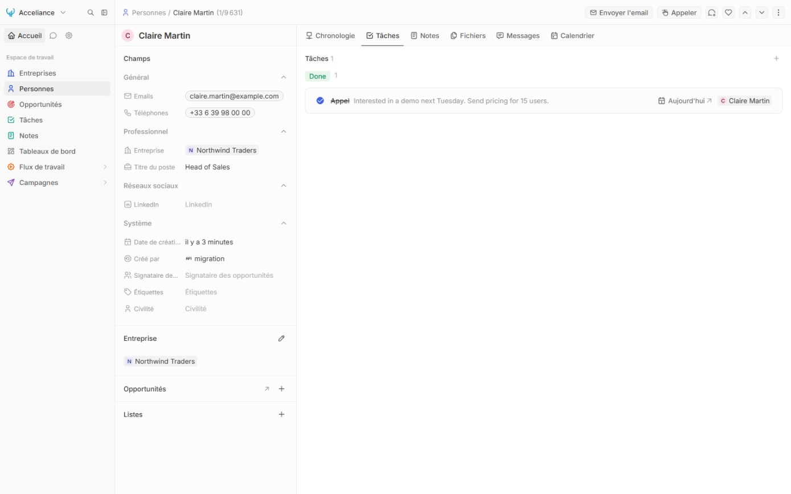

[](https://www.acceliance.fr)

# Click to Call for Twenty, offered by Acceliance

**Your sales team calls contacts from their Android phone in one click, straight from [Twenty CRM](https://twenty.com), and every call is logged automatically. Free, open source, self-hostable.**

[](https://www.acceliance.fr)
[](LICENSE)
[](https://www.npmjs.com/package/@acceliance/twenty-click-to-call)
[](https://github.com/acceliance/twenty-click-to-call/actions/workflows/ci.yml)
[](https://twenty.com)
[](https://ntfy.sh)
[](https://play.google.com/store/apps/details?id=io.heckel.ntfy)
[](#languages)
[](#requirements)

> **Using Twenty for sales?** Acceliance built this app for its own team and **offers** it to the Twenty community.
> Questions, feedback or a custom integration: **[contact@acceliance.fr](mailto:contact@acceliance.fr?subject=Twenty%20Click%20to%20Call)**.

---

## 🚀 Why Click to Call?

Salespeople live in the CRM but call from their mobile. Copying numbers by hand is slow, error-prone, and calls rarely
get logged.

| | Before | With Click to Call |
|---|---|---|
| 📞 **Dialing** | Read the number on screen, type it on the phone | One click in Twenty, one tap on the phone |
| ✅ **Accuracy** | Typos, wrong country code | Number normalized to international format (`+33…`) |
| 📝 **Activity log** | Calls forgotten in the CRM | Every call logged as a done task on the contact, assigned to the caller |
| 🗒️ **Call notes** | Written later, if ever | The task opens right away in the side panel, ready for notes |
| 🔐 **Privacy** | Numbers in third-party apps | Push through **your own** ntfy server; nothing else leaves your infrastructure |
| 📱 **Setup** | Custom mobile app to build and maintain | The free ntfy Android app, configured in two minutes |

## ✨ What it does

1. Click **Call** on a person in Twenty.
2. Your phone gets a push notification with the contact's name, company and number.
3. Tap it: the phone's dialer opens with the number ready. Press call.
4. The call is logged as a **done task** on the contact, assigned to you, and opens in the side panel so you can take notes.

Notifications go through [ntfy](https://ntfy.sh), an open-source push service you can self-host. No custom mobile app is needed: your team uses the free ntfy Android app.

> Android never lets an app place a call silently: the dialer opens and the user presses call.

## 📸 Screenshots

**1. One click on the contact.** The **Call** button (here in French, "Appeler") sits next to "Send email" on every person.



**2. The call is logged and opened.** While the phone rings the dialer, Twenty creates a done task, assigned to you and linked to the contact, and opens it for your notes.



**3. Every call stays in the contact's history.**



*Screenshots use a fictional contact.*

## How it works

```
Person ─[Call]─► front component ─POST /s/click-to-call/notify─► logic function
   reads the contact with the caller's permissions, builds +33…, publishes to ntfy topic <prefix><user>
                                             ▼
                          ntfy server ─► ntfy Android app ─tap─► dialer (tel:+33…)
```

Each user receives notifications on their own topic: `<prefix>` + the part of their Twenty email before the `@`, made topic-safe. For `jane.doe@example.com` with the default prefix, that's `call-jane-doe`.

## Requirements

- Twenty 2.59 or later, with logic functions enabled on self-hosted servers (`LOGIC_FUNCTION_TYPE=LOCAL` or `LAMBDA`).
- An ntfy server with access control. Self-hosting is strongly recommended: notifications contain contact names and phone numbers. A Docker setup takes a few minutes ([ntfy docs](https://docs.ntfy.sh/install/)).
- Android phones with the [ntfy app](https://play.google.com/store/apps/details?id=io.heckel.ntfy).

## Setup

### 1. ntfy server

Run ntfy with `auth-default-access: deny-all`, then create a publisher account and a token for Twenty:

```bash
ntfy user add twenty
ntfy access twenty 'call-*' write-only
ntfy token add twenty            # copy the tk_… token
```

For each Twenty user (here `jane.doe@example.com`):

```bash
ntfy user add jane-doe
ntfy access jane-doe call-jane-doe read-only
```

### 2. App settings in Twenty

Install the app, then open **Settings → Apps → Click to Call → Variables**:

| Variable | Required | Default | Description |
| --- | --- | --- | --- |
| `NTFY_URL` | yes | | Your ntfy server, e.g. `https://ntfy.example.com` |
| `NTFY_TOKEN` | yes | | The publisher token (`tk_…`), stored as a secret |
| `NTFY_TOPIC_PREFIX` | no | `call-` | Topic prefix for each user |
| `CALL_TASK_TITLE` | no | `Call` | Title of the logged task (e.g. `Appel`). Empty = no task |

### 3. Each phone

In the ntfy app: **Settings → Manage users → Add user** with your ntfy server and account, then **+** → topic `call-jane-doe`, tick **Use another server**, enter your server URL and turn on **Instant delivery**.

Reload Twenty after installing or updating the app to see the button.

## Permissions

The app reads the contact and the caller's workspace member, and creates the call task and its link to the contact. It never deletes records. Every action runs with the clicking user's own permissions on top of the app's role.

## Languages

English and French (`locales/`). Contributions for other languages are welcome: run `twenty app translations extract --locale <locale>`.

## Development

Requires Node 24.5+ and Yarn 4 (on Windows, use WSL 2).

```bash
npm install -g twenty
yarn install
twenty auth login --url https://your-twenty.example.com
yarn typecheck && yarn test:unit
twenty app apply --create   # first install; then `twenty app dev` or `twenty app apply`
```

Releases are published to npm from GitHub Actions with provenance (`.github/workflows/publish.yml`): bump `version` in `package.json`, then push a `vX.Y.Z` tag.

## License

[MIT](LICENSE) © Acceliance

---

## 🏆 Built by Acceliance

Click to Call is a small example of how **Acceliance** connects business tools with automation: a CRM button, a
serverless function, a self-hosted push service and the phone's own dialer, assembled into one smooth workflow with
no new mobile app to maintain.

- **Twenty CRM apps**: buttons, logic functions, workflows, data models and integrations for your sales process;
- **AI automation**: knowledge graphs, RAG, agents (MCP, A2A), governed AI and model-centric architectures;
- **Sovereign deployments**: on-premise or on the host of your choice, GDPR and AI Act ready.

Want the same approach for your own processes? **[Let's talk](mailto:contact@acceliance.fr?subject=Twenty%20%2F%20AI%20project)**.
See also our free AI candidate-matching platform, [CVMatcher](https://github.com/acceliance/CVMatcher-Deploy), and our
prompt generator, [MasterPrompter](https://masterprompter.acceliance.fr).

## 🤝 About Acceliance

**Acceliance** designs AI and automation architectures and solutions: knowledge graphs, RAG, agents, business
modeling, AI governance and sovereign deployments.

📧 [contact@acceliance.fr](mailto:contact@acceliance.fr) · 🌐 [www.acceliance.fr](https://www.acceliance.fr) ·
🐙 [github.com/acceliance](https://github.com/acceliance)

**Your CRM knows who to call. Now your phone does too.**
